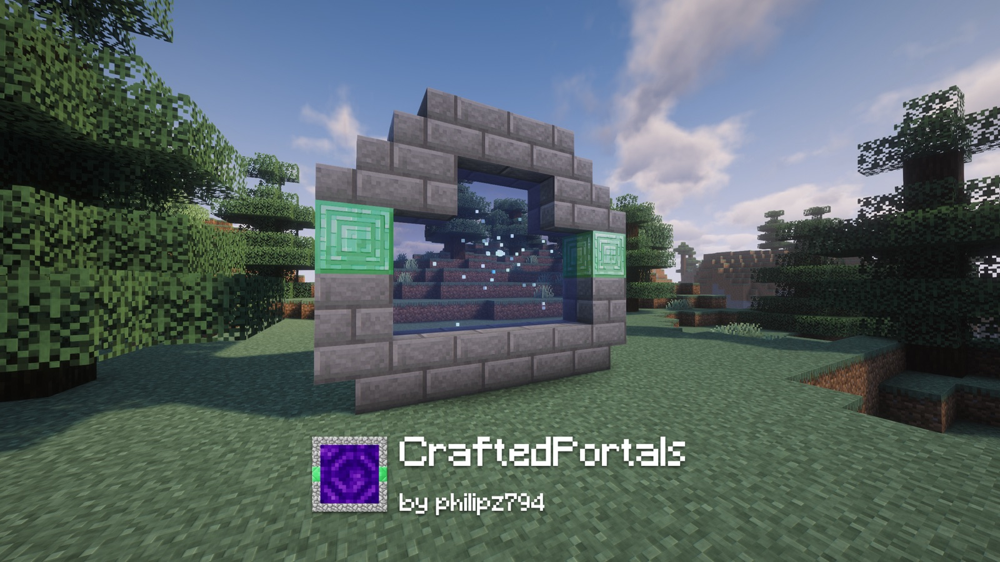
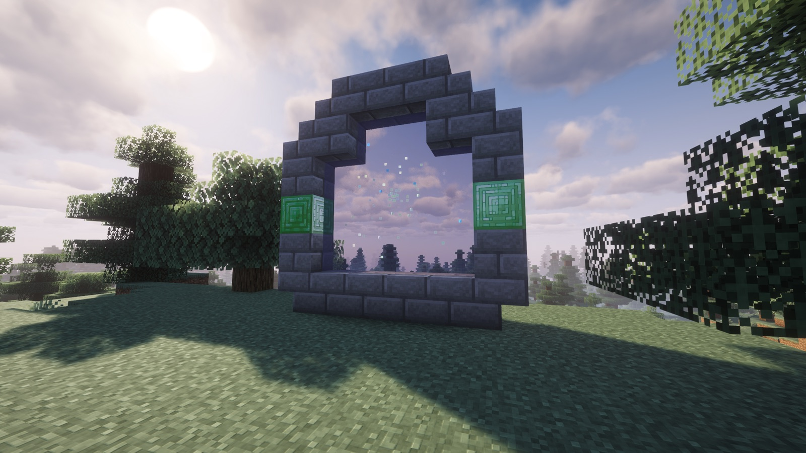
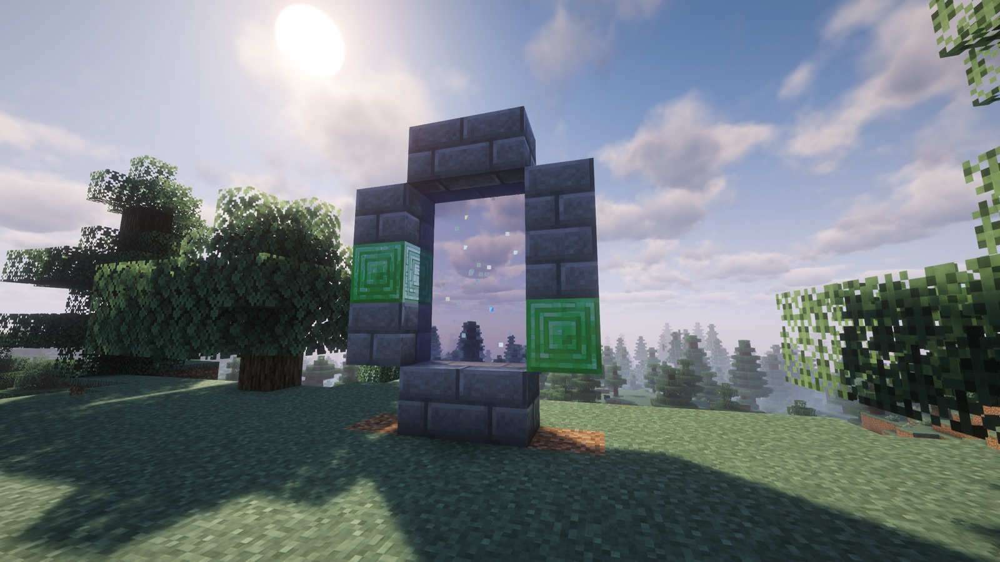
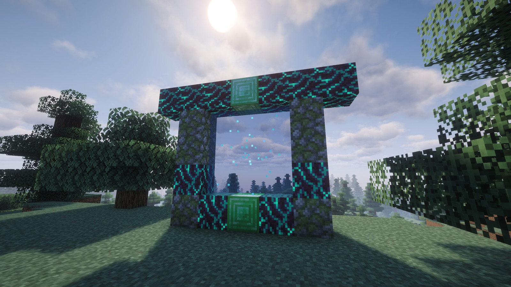

# CraftedPortals

[](https://modrinth.com/project/craftedplugins)
[](https://github.com/philipz794/CraftedPortals/releases)
[](LICENSE)



A server-side [Paper](https://papermc.io) plugin that lets players build portals out of **any solid blocks**
in **any shape** and link them with a **renamed item**, a clock by default. No client mods required;
works for Java and Bedrock players (via Geyser/Floodgate). Inspired by
[CreativeGates](https://github.com/JeremyFail/CreativeGates), rebuilt from scratch as a lightweight
plugin without dependencies.

## Features

- **Any blocks, any shape.** Build a vertical frame from any solid blocks, including soul sand, mud and
  end portal frames, in any closed shape: rectangle, L, cross, heart, arrow. Blocks that only touch the
  inside diagonally (corners) are optional.
- **A named item is the key.** Rename a clock (or any item you configure) on an anvil and right-click the
  frame. The item's name becomes the network name. Portals with the same name form a loop: 1 → 2 → 3 → 1.
  Add a hex colour, `Home #3366FF`, and that network gets its own colour.
- **Cross-dimensional.** Overworld ↔ Nether ↔ End, no portal generation, no vanilla portal logic.
- **Everyone travels.** Players, mobs, thrown items and leashed animals (they follow their owner). Each
  can be switched off.
- **Three looks.** By default a translucent coloured sheet with particle streaks; or classic nether portal
  blocks, or end gateway blocks. 123 particle types with colour, item and size options; switch live with
  `/cp reload`.
- **Travel feedback.** While a survival player waits: nausea, frost, darkness or nothing, plus particles,
  a swelling sound and a progress bar; an arrival message and sound at the destination. All optional and
  independent of the portal look.
- **Sounds you choose.** Ambience, travel and arrival sounds accept any game sound or a resource pack key,
  with volume and pitch. The ambience plays at random moments like vanilla's portal blocks.
- **Sturdy.** Frames are protected from pistons and fluids. Breaking a frame block removes only that
  portal; the rest of the network keeps its order. Zombified piglins do not spawn from portal blocks
  unless you allow it.
- **Painless updates.** New options are added to your existing `config.yml` with their comments, renamed
  options are converted, obsolete ones removed. Your values and translations stay untouched.

## Screenshots

<table>
  <tr>
    <td width="33%"></td>
    <td width="33%"></td>
    <td width="33%"></td>
  </tr>
  <tr>
    <td align="center"><sub>Any shape, not just rectangles</sub></td>
    <td align="center"><sub>Classic frame, corners left out</sub></td>
    <td align="center"><sub>Mix any blocks, just include the key blocks</sub></td>
  </tr>
</table>

## Requirements

- Paper 26.3 or newer (API version 1.21)
- Java 21 runtime on the server

## Installation

1. Download `craftedportals-<version>.jar` from [Modrinth](https://modrinth.com/project/craftedplugins) or the
   [GitHub releases](https://github.com/philipz794/CraftedPortals/releases), or build it yourself (see below).
2. Drop it into your server's `plugins/` folder and start the server.
3. Adjust `plugins/CraftedPortals/config.yml` as needed, then run `/cp reload`.

## Usage

1. Build a vertical frame from solid blocks in any closed shape. Somewhere inside there must be two blocks
   of air stacked vertically so a player fits through.
2. Include at least 2 emerald blocks in the frame (block type and count are configurable).
3. Rename the activation item, a clock by default, on an anvil, e.g. `Home`, and right-click the frame
   with it. The item is consumed.
4. Build a second frame anywhere, activate it with an item named `Home` too.
5. Walk through. Survival players wait three seconds, creative players travel instantly.

A frame with a dividing pillar encloses two openings and therefore gives two portals.

## Commands

| Command | Description |
|---|---|
| `/cp list` | List all networks and portals |
| `/cp reload` | Reload the configuration and switch visuals live |
| `/cp create <name> <x> <y> <z> [world]` | Activate the frame at the given block without an item (also from console) |

`/craftedportals` is the long form of `/cp`. Permission: `craftedportals.admin` (default: op).

## Configuration

See [`config.yml`](src/main/resources/config.yml) for all options and messages. Highlights:

| Option | Default | Description |
|---|---|---|
| `activation-item` | `CLOCK` | Item that activates portals when renamed |
| `key-block` / `key-block-count` | `EMERALD_BLOCK` / `2` | Block type and minimum count required in the frame |
| `max-blocks` | `200` | Maximum number of air blocks inside a portal (hard limit 1000) |
| `effect` | `PARTICLE` | `NETHER`, `END` or `PARTICLE` visuals; 123 particle types with options, see [docs/particles.md](docs/particles.md) |
| `particles.sheet` | on, `#4169E1`, 50 % | Translucent coloured sheet for the PARTICLE look (Java clients; Bedrock sees the particles) |
| `player-delay-ticks` | `60` | Time a survival player has to stand in the portal |
| `travel-effect` | `NAUSEA` | Screen effect while waiting: `NAUSEA`, `FROST`, `DARKNESS` or `NONE` |
| `ambient-sound` / `travel-sound` / `arrival-sound` | on | Any game sound or resource pack key, each with volume and pitch |
| `travel-particles` / `travel-bar` | on | Particles around the waiting player, progress bar in the action bar |
| `consume-item` | `true` | Consume the item on activation (never in creative) |
| `teleport-mobs` / `teleport-items` / `leashed-follow` | `true` | Who else may travel |
| `piglin-spawn` | `false` | Allow zombified piglins to spawn from portal blocks |

All messages support `&` colour codes and can be translated. Unknown values fall back to safe defaults
and admins are told in chat.

## Building

Requires Maven and JDK 25 or newer (the Paper API is compiled for Java 25; the plugin itself targets Java 21).

```
mvn package
```

The jar is written to `target/`. See [docs/build.md](docs/build.md) for details.

## Why CraftedPortals?

The idea of building gates from any blocks and linking them with a named item comes from
[CreativeGates](https://github.com/JeremyFail/CreativeGates) by MassiveCraft, a classic that is being
continued today. CraftedPortals is an independent, from-scratch implementation of that concept with a
different focus:

- **Lightweight.** One jar, no library plugin required, a handful of classes.
- **Zero dependencies.** Public Paper API only, no NMS, so updates to new Minecraft versions are cheap.
- **Bedrock friendly.** Everything players see is a right-click and an action bar message, which works
  through Geyser/Floodgate. No chat UIs or dialogs.
- **Server owner first.** A single `config.yml` with comments, updated automatically when new options
  arrive; portals survive restarts in a plain YAML file.

If you need per-player permissions, management dialogs or many gate fill types, CreativeGates is the
more complete choice. If you want portals that just work on a small or medium server, this is for you.

## Documentation

Developer documentation lives in [`docs/`](docs/README.md).

## License

[MIT](LICENSE)
